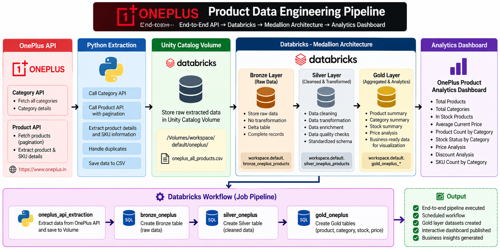
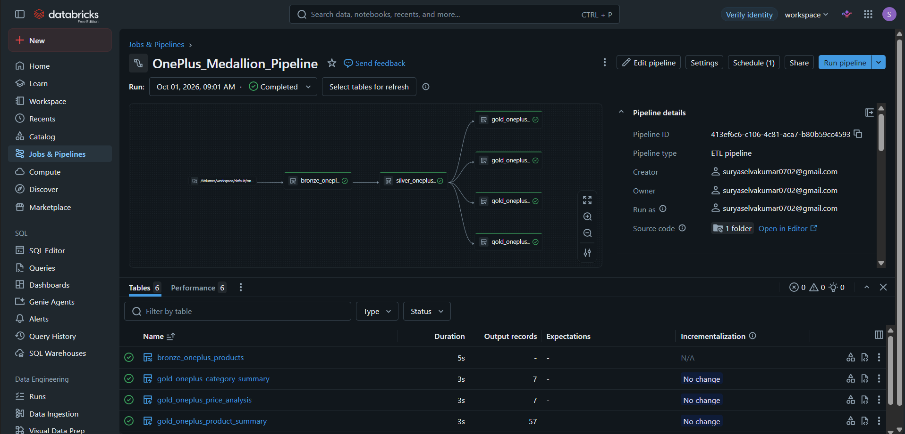
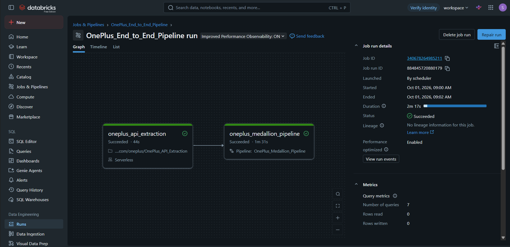

# OnePlus Product Data Engineering Pipeline

## 📌 Project Overview

This project implements an end-to-end **Data Engineering pipeline** for extracting OnePlus product data from APIs, storing the raw data, transforming it through the **Medallion Architecture**, and creating business-ready datasets for analytics.

The pipeline is developed using **Python, SQL, Databricks, Delta Lake, Unity Catalog, and Databricks Workflows**.

---

## 🏗️ Architecture

```text
OnePlus API
     │
     ▼
Python API Extraction
     │
     ▼
CSV / Unity Catalog Volume
     │
     ▼
┌───────────────────────────────┐
│       BRONZE LAYER            │
│       Raw API Data            │
└───────────────┬───────────────┘
                │
                ▼
┌───────────────────────────────┐
│       SILVER LAYER            │
│ Cleaning + Transformation     │
│ Data Quality Validation       │
└───────────────┬───────────────┘
                │
                ▼
┌───────────────────────────────┐
│        GOLD LAYER             │
│ Business Aggregations         │
│ Product / Category / Stock    │
│ Pricing Analysis              │
└───────────────┬───────────────┘
                │
                ▼
       Databricks Dashboard
```



---

## 🎯 Project Objectives

- Extract OnePlus product information from APIs.
- Handle API pagination.
- Extract product and SKU-level information.
- Store raw extracted data in Databricks Volumes.
- Implement Medallion Architecture.
- Create Bronze, Silver and Gold Delta tables.
- Perform data cleaning and quality validation.
- Create business-level aggregations.
- Analyze product pricing and stock availability.
- Build an interactive Databricks dashboard.
- Orchestrate the complete pipeline using Databricks Workflows.

---

## 🛠️ Technologies Used

| Technology | Purpose |
|---|---|
| Python | API extraction and data processing |
| Pandas | CSV processing |
| REST API | Data source |
| Databricks | Data engineering platform |
| Unity Catalog | Data governance and storage |
| Databricks Volumes | Raw file storage |
| Delta Lake | Table storage |
| SQL | Data transformation |
| Medallion Architecture | Data organization |
| Databricks Workflows | Pipeline orchestration |
| Databricks SQL Dashboard | Data visualization |
| Git / GitHub | Version control |

---

# 🔄 Data Pipeline

## 1. API Extraction

Python is used to extract product data from the OnePlus API.

The extraction process includes:

- Fetching product categories
- Fetching products
- Handling pagination
- Extracting product information
- Extracting SKU information
- Capturing pricing information
- Capturing stock information
- Saving the extracted data as CSV

The extracted file is stored in a Databricks Volume:

```text
/Volumes/workspace/default/oneplus/oneplus_all_products.csv
```

### Extraction Result

The API extraction successfully produced:

- **131 rows**
- **27 columns**

---

# 🥉 Bronze Layer

The Bronze layer stores the raw extracted data.

### Purpose

- Preserve raw source data
- Maintain the original structure
- Provide a source layer for downstream processing
- Enable data recovery and reprocessing

Example table:

```text
workspace.default.bronze_oneplus_products
```

---

# 🥈 Silver Layer

The Silver layer performs data cleaning and transformation.

### Main Operations

- Data type standardization
- Duplicate handling
- Column standardization
- Data quality validation
- Stock status validation
- Price validation
- Record classification using data quality flags

Example table:

```text
workspace.default.silver_oneplus_products
```

The Silver layer acts as the trusted and cleaned data layer for the Gold transformations.

---

# 🥇 Gold Layer

The Gold layer contains business-ready analytical datasets.

Four Gold tables were created.

### 1. Product Summary

```text
workspace.default.gold_oneplus_product_summary
```

Provides:

- Category
- Product name
- Product code
- SKU count
- Minimum price
- Maximum price
- Average price
- Average discount
- In-stock SKU count
- Out-of-stock SKU count
- Low-stock SKU count
- Valid records
- Flagged records

---

### 2. Category Summary

```text
workspace.default.gold_oneplus_category_summary
```

Provides category-level:

- Product count
- SKU count
- Average price
- Minimum price
- Maximum price
- Average discount
- In-stock SKUs
- Out-of-stock SKUs
- Low-stock SKUs

---

### 3. Stock Summary

```text
workspace.default.gold_oneplus_stock_summary
```

Provides:

- Category
- Stock status
- Product count
- SKU count

This dataset is used for stock availability analysis.

---

### 4. Price Analysis

```text
workspace.default.gold_oneplus_price_analysis
```

Provides:

- Product count
- Minimum original price
- Maximum original price
- Average original price
- Minimum current price
- Maximum current price
- Average current price
- Average discount

---

# ⚙️ Databricks Workflow

The complete pipeline is orchestrated using a Databricks Job.

```text
oneplus_api_extraction
          │
          ▼
oneplus_medallion_pipeline
          │
          ▼
Bronze → Silver → Gold
```

The end-to-end workflow was successfully executed.

The workflow contains:

### Task 1

```text
oneplus_api_extraction
```

Extracts data from the OnePlus API and stores it in the Databricks Volume.

### Task 2

```text
oneplus_medallion_pipeline
```

Processes the data through the Medallion Architecture.

---

# 📊 Dashboard

A Databricks dashboard was created using the Gold-layer datasets.

## KPI Cards

The dashboard contains:

- Total Products
- Total Categories
- In Stock Products
- Average Current Price

## Visualizations

### Product Count by Category

Shows the number of products available in each category.

### Stock Status by Category

Compares:

- In Stock
- Out of Stock

for each category.

### Average Current Price by Category

Shows average current product price across categories.

### Minimum vs Maximum Current Price

Compares minimum and maximum current prices by category.

### Average Discount by Category

Shows average discount values across categories.

### SKU Count by Category

Shows the number of SKUs available in each category.

---

# 📸 Project Screenshots

## API Extraction


## Medallion Pipeline



## Workflow Run



## Dashboard


---

# 📁 Project Structure

```text
OnePlus_Data_Engineering/
│
├── notebooks/
│   ├── OnePlus_API_Extraction.py
│   ├── bronze_oneplus.sql
│   ├── silver_oneplus.sql
│   └── gold_product.sql
│
├── screenshots/
│   ├── api_extraction.png
│   ├── medallion_pipeline.png
│   ├── workflow_run.png
│   └── dashboard.png
│
├── architecture/
│   └── architecture.png
│
├── README.md
└── .gitignore
```

---

# 🚀 Key Data Engineering Concepts Demonstrated

This project demonstrates practical knowledge of:

- REST API extraction
- API pagination
- Python data processing
- Pandas
- CSV ingestion
- Databricks Volumes
- Unity Catalog
- Delta Lake
- SQL transformations
- Data cleaning
- Data quality checks
- Medallion Architecture
- Bronze/Silver/Gold layers
- Aggregations
- Business analytics
- Databricks Workflows
- Pipeline orchestration
- Dashboard development
- Git and GitHub

---

# 🔍 Data Quality

The Silver layer uses a data quality flag:

```text
VALID
```

Records marked as valid are used for Gold-layer business analysis.

The Gold layer therefore provides cleaned and business-ready datasets instead of directly exposing raw API data.

---

# 📈 Business Use Cases

The pipeline can be used to analyze:

- Product availability
- Category-wise product distribution
- SKU availability
- Stock status
- Product pricing
- Price ranges
- Discounts
- Category-level pricing trends

---

# 👨‍💻 Author

**Surya S**

B.Tech Information Technology

Data Engineering Project

---

## ⭐ Project Summary

This project demonstrates an end-to-end data engineering workflow:

```text
API
 ↓
Python
 ↓
Databricks Volume
 ↓
Bronze
 ↓
Silver
 ↓
Gold
 ↓
Databricks Workflow
 ↓
Analytics Dashboard
```

The project combines data ingestion, transformation, quality validation, orchestration, and visualization into a complete Data Engineering pipeline.